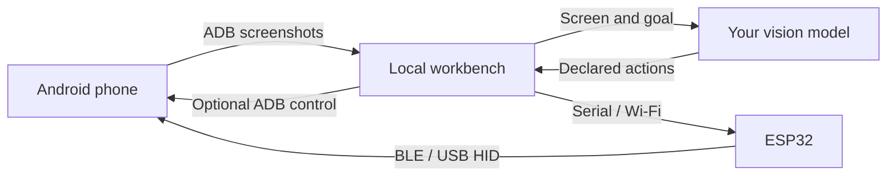

# ESP32 Android Agent

**Let a vision AI operate your real Android phone from your own computer.**

[简体中文](README.md) · [Quick start](#quick-start) · [Real phone examples](#real-phone-examples) · [Compatibility](docs/COMPATIBILITY.md) · [Contributing](CONTRIBUTING.md)

An ESP32 sends keyboard and mouse input, ADB provides screenshots, and a vision model plans and verifies actions. The service runs locally with Python, FastAPI and static web assets. No Android companion app or root is required. **ADB control mode** lets you try it before buying a board.


*The production workbench after a read-only native-note verification task. The device identifier is redacted. See [image provenance](docs/images/README.md).*

## Why this design

- **Try it first.** ADB control needs no board. Manual control needs no model account, so you can check the screen and input before starting an automatic task.
- **Use common hardware.** Classic ESP32 boards act as BLE keyboards/mice without occupying the phone's USB port. S3 profiles offer native USB HID; the installation wizard checks chip and flash compatibility.
- **One less phone-side installation.** Standard ADB screenshots avoid a companion app's installation, capture permissions and background lifecycle. You still need to enable and authorize Android debugging.
- **Inspect the reasoning and result.** The workbench shows plans, actions, screen evidence and usage. Each action is verified; a model's completion claim receives an independent full-goal check.
- **Pause and take over.** Stop releases input. Lost screens or connections pause execution. Uncertain input is observed before recovery, and HID failure never silently switches to ADB input.
- **Maintain firmware in the browser.** Identify → back up and download the full flash → explicitly confirm overwrite → write and read back. Normal pairing/provisioning does not require editing source code.
- **Keep local records and choose your model.** Use an OpenAI-compatible vision endpoint, including a compatible local service. Screenshot saving is off by default; task records can be exported. Automatic tasks send screenshots to the model endpoint you configure.

| Route | Phone setup | Starting point |
|---|---|---|
| ADB screenshots + ADB control | Authorized USB or wireless debugging | Try without hardware and check basic input |
| ADB screenshots + classic ESP32 BLE HID | Debugging authorization + Bluetooth HID pairing | Common ESP32 hardware; phone USB remains available for the computer |
| Wireless ADB screenshots + S3 USB HID | Wireless debugging + OTG / native USB | S3 hardware route; phone-side acceptance is still pending |

## How it works



**Eyes:** authorized ADB screenshots. **Hands:** ESP32 BLE, S3 USB HID or explicit ADB control. **Brain:** plan → observe → validate one action → serialize input → verify the screen, with action, time and token budgets.

## Quick start

Install **Python 3.10+** and Google's [Android Platform Tools](https://developer.android.com/tools/releases/platform-tools). Normal use does not require Node, Arduino IDE or development dependencies.

Windows / PowerShell:

```powershell
git clone https://github.com/shenlan-ai/esp32-android-agent.git
cd esp32-android-agent
python -m venv .venv
.venv\Scripts\python -m pip install -e "./server"
.venv\Scripts\python -m android_agent --open-browser
```

macOS / Linux:

```bash
git clone https://github.com/shenlan-ai/esp32-android-agent.git
cd esp32-android-agent
python3 -m venv .venv
.venv/bin/python -m pip install -e ./server
.venv/bin/python -m android_agent --open-browser
```

1. Enable Developer options and USB debugging, connect a data cable, unlock the phone and authorize your computer.
2. Open `http://127.0.0.1:8890`, refresh devices and connect your phone. Check the screen and a harmless manual tap in **ADB control** mode.
3. For automatic tasks, save your vision model's API base URL, model name and optional key under model settings, then test it. The connection test uses a synthetic image; real tasks send phone screenshots.
4. Prepare a clear starting screen and use a short goal, such as “Open Settings and report whether Wi-Fi is enabled; do not change anything.” Watch execution, pause to take over, or press Esc to stop.

Pass `--adb <absolute-path>` if ADB is not on PATH. `--diagnose` checks the environment; `--port` changes the workbench port. Wireless pairing and connection use separate ports, with discovery and manual entry in the workbench. See [English usage](docs/USAGE.en.md) and [reproducible goals](docs/EXAMPLES.md).

### Add an ESP32

| Firmware profile | Chip / flash | Input route | Current evidence |
|---|---|---|---|
| `esp32dev` | Classic ESP32 / 4MB | Computer serial → BLE HID | ESP32-D0WD-V3 rev 3.1 + Redmi Note14 5G tested |
| `esp32_s3_devkitc` | S3 DevKitC-1 N8 / 8MB | Wi-Fi → native USB HID | Compiled and host protocols simulated; phone acceptance pending |
| `xiao_esp32s3` | XIAO ESP32S3 / 8MB | Wi-Fi → native USB HID | Same software-only evidence |
| `esp32_s3_zero` | S3 Zero / 4MB | Wi-Fi → native USB HID | Same software-only evidence |

Keep a classic ESP32 attached to the computer. Pair **Android Agent BLE** on the phone, confirm the target phone in the workbench, select BLE control and calibrate the pointer. S3 is provisioned through native USB on the computer, then moved to the phone's OTG port; screenshots require wireless ADB. [English hardware setup](docs/USAGE.en.md#esp32-hardware).

Source users need the optional `./server[firmware]` dependency and a built image catalog for the web installation wizard, selected with `--firmware-dir <directory>`. See [development instructions](docs/DEVELOPMENT.md). Chip identification cannot establish the commercial PCB model. A CP2102 / CH340 serial bridge does not prove native USB HID support.

### Windows portable package

The Windows x64 build contains Python, the workbench, four firmware profiles, a separate flashing tool, licenses and corresponding sources. Extract the complete directory and run the executable; install Platform Tools separately from Google. **There is no official binary Release yet.** A local development package passed extracted-executable checks in a path containing Chinese characters and spaces. Contributors can [build it](docs/PORTABLE.md) or manually run the GitHub artifact workflow.

## Real phone examples


Tested on 2026-10-13 using Windows, **Redmi Note14 5G / Android 15 / API 35**, ESP32-D0WD-V3 / 4MB, BLE **0.1.4**, and the configured `deepseek-flash` model:

| Example | Observed result | Scope |
|---|---|---|
| Draw a smiley | Model chose 2 circles + 1 path; 114.91 seconds, 3 inputs; independent final check passed | Local whiteboard in phone Edge; angular mouth. Not native drawing-app acceptance or precision-curve evidence |
| Create a native hello note | Model created and typed it. After manual intervention, a separate read-only task verified the newer note was saved: 133.03 seconds, 3 taps | Creation task failed to finish automatically; an old test draft was also mistakenly selected. Stable single-run completion is unproven |

Closed paths, circles and release during motion also have real pointer-event and screenshot evidence. The [physical-device report](docs/acceptance/2026-10-13-redmi-note14-ble.md) retains failures and recovery history. These single-device examples are not a success-rate benchmark.

## Current limits

Android 15 / 16 / 17 are compatibility targets. **Physical evidence currently covers only the Android 15 device above.** Other brands, Android 16/17, S3 hardware, rotation and cable-loss checks remain pending. Relative HID pointer input depends on acceleration and calibration; full-screen pixel accuracy is not guaranteed. Text is printable ASCII. Users switch their IME to English; automatic IME switching and Unicode input are not implemented.

Screens come from ADB screenshots. scrcpy video ingestion, companion apps and parallel phones are not implemented. Protected/black screens pause execution. Models can misjudge; inspect the real result. [Compatibility and software evidence](docs/COMPATIBILITY.md) · [Acceptance checklist](docs/ACCEPTANCE.md) · [Privacy and security](SECURITY.md).

## Development and contribution

**Every change uses OpenSpec**, including code, firmware, documentation and tools. [AGENTS.md](AGENTS.md) is authoritative; [agent.md](agent.md) links to it. Read the [development workflow](docs/DEVELOPMENT.md) and [contribution guide](CONTRIBUTING.md). Offline fixtures use fake phone/model IO and visibly display DEMO.

```text
python -m pip install -e "./server[dev]"
python -m pytest -q server/tests
python -m ruff check --config server/pyproject.toml server scripts tools packaging
node --test server/tests/geometry.test.mjs server/tests/board-status.test.mjs
python -m unittest discover -s scripts/tests
openspec validate --all --strict --no-interactive
openspec validate --archived --no-interactive
python scripts/check_changes.py
```

CI is configured for Ubuntu/Windows × Python 3.10/3.12, web tests and four firmware builds, without devices or paid model services. [Architecture](docs/ARCHITECTURE.zh-CN.md) · [Publication checklist](docs/RELEASING.md).

## Upstream and licenses

Thanks to [onehumanbeing/esp32-iphone-agent](https://github.com/onehumanbeing/esp32-iphone-agent). This project builds on its vision + ESP32 HID approach and portions of code; upstream attribution is preserved in [NOTICE](NOTICE).

Application code is [MIT](LICENSE). The separate [firmware tool](tools/firmware_worker.py) and esptool are **GPL-2.0-or-later**; other firmware dependencies retain their own licenses. Portable distributions include component notices and corresponding sources; the entire package is not all MIT.
