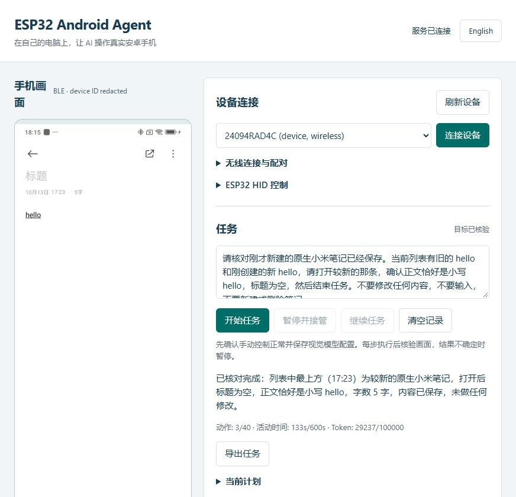
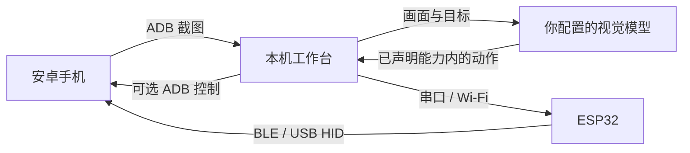
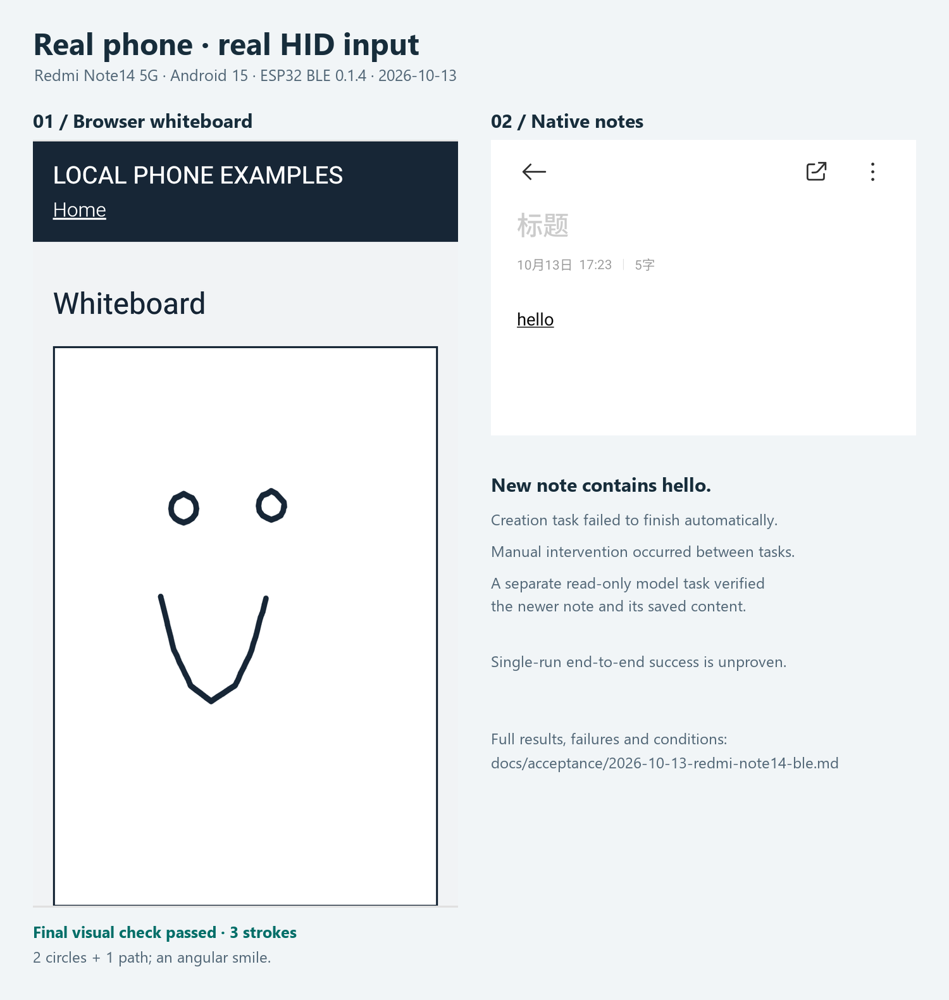

# ESP32 Android Agent

**在自己的电脑上，让视觉 AI 操作真实安卓手机。**

[](https://github.com/shenlan-ai/esp32-android-agent/actions/workflows/ci.yml)

[English](README.en.md) · [快速开始](#快速开始) · [实机案例](#真实手机案例) · [兼容性](docs/COMPATIBILITY.md) · [贡献](CONTRIBUTING.md)

ESP32 负责键鼠输入，ADB 提供手机画面，视觉模型负责规划、执行与核验。服务在本机运行，使用 Python + FastAPI + 静态网页；手机无需安装伴侣 App，也无需 root。没有开发板时，可以先用 **ADB 控制模式**体验。



*真实工作台截图：原生笔记保存核验任务已完成。设备标识已遮盖；截图来源与处理见[素材说明](docs/images/README.md)。*

## 为什么这样设计

- **先体验，再接硬件。** ADB 模式无需 ESP32；手动控制无需模型账号，先确认连接、画面和输入，再运行自动任务。
- **常见开发板也能用。** 经典 ESP32 通过 BLE 键鼠控制手机，不占手机 USB 口；S3 提供原生 USB HID 路线，板型与 Flash 容量由安装向导核对。
- **少一层手机端安装。** 画面通过标准 ADB 获取，无需额外伴侣 App 的投屏权限、签名或后台保活配置。仍需在手机开启并授权调试。
- **看得到每一步的依据。** 网页显示计划、动作原因、画面证据与用量；动作后核验，模型说“完成”后再独立核验完整目标。
- **能够暂停和接管。** 停止会释放输入；断线或画面丢失暂停自动操作，未知输入结果先观察，HID 失败不会悄悄切换为 ADB 输入。
- **固件维护进入网页。** 识别芯片 → 完整备份并下载 → 明确确认覆盖 → 写入并读取校验，不要求用户修改源码后才能配对或配网。
- **本机记录、可换模型。** 支持 OpenAI 兼容视觉接口与本地兼容服务，截图存盘默认关闭，任务可导出。自动任务的截图会发送到你配置的模型端点。

| 使用路线 | 手机端准备 | 适合的起点 |
|---|---|---|
| ADB 画面 + ADB 控制 | 授权 USB 或无线调试 | 无硬件试用、确认基本操作 |
| ADB 画面 + 经典 ESP32 BLE HID | 调试授权 + 蓝牙键鼠配对 | 常见 ESP32 硬件输入；手机 USB 可继续接电脑 |
| 无线 ADB 画面 + ESP32-S3 USB HID | 无线调试 + OTG / 原生 USB | S3 硬件路线；手机输入实测仍待完成 |

## 如何工作



**Eyes / 画面：** 已授权的 USB 或无线 ADB 截图。**Hands / 输入：** ESP32 BLE、S3 USB HID 或显式 ADB 模式。**Brain / 闭环：** 规划 → 新画面决策 → 严格动作校验 → 串行输入 → 画面核验，配合动作数、时间和 Token 预算。

## 快速开始

需要 **Python 3.10+** 和 Google 官方 [Android Platform Tools](https://developer.android.com/tools/releases/platform-tools)。普通运行无需 Node、Arduino IDE 或开发依赖。

Windows / PowerShell：

```powershell
git clone https://github.com/shenlan-ai/esp32-android-agent.git
cd esp32-android-agent
python -m venv .venv
.venv\Scripts\python -m pip install -e "./server"
.venv\Scripts\python -m android_agent --open-browser
```

macOS / Linux：

```bash
git clone https://github.com/shenlan-ai/esp32-android-agent.git
cd esp32-android-agent
python3 -m venv .venv
.venv/bin/python -m pip install -e ./server
.venv/bin/python -m android_agent --open-browser
```

1. 手机开启“开发者选项 → USB 调试”，用数据线连接电脑，解锁并允许调试授权。
2. 打开 `http://127.0.0.1:8890`，刷新设备、选择手机并连接；先在 **ADB 控制模式**查看画面、测试无副作用的手动点击。
3. 自动任务需要视觉模型：在“模型与运行设置”保存 API 基础地址、模型名和可选密钥，点击“测试模型”。测试只使用合成图；真实任务才发送手机截图。
4. 准备明确的起始画面，输入一个短目标，例如“打开设置，查看 Wi-Fi 是否开启，不修改设置”。观察执行，必要时暂停接管或按 Esc 停止。

ADB 不在 PATH 时传入 `--adb <绝对路径>`；`--diagnose` 检查环境，`--port` 更换端口。无线配对和连接使用不同端口，网页提供发现与手动连接入口。详见[自动任务与人工接管](docs/AGENT-USAGE.md)、[可复现示例](docs/EXAMPLES.md)。

### 接入 ESP32

| 固件配置 | 芯片 / Flash | 控制方式 | 当前验证 |
|---|---|---|---|
| `esp32dev` | 经典 ESP32 / 4MB | 电脑串口 → BLE HID | ESP32-D0WD-V3 rev 3.1 + Redmi Note14 5G 实测 |
| `esp32_s3_devkitc` | S3 DevKitC-1 N8 / 8MB | Wi-Fi → 原生 USB HID | 编译、主机协议模拟通过；手机实测待完成 |
| `xiao_esp32s3` | XIAO ESP32S3 / 8MB | Wi-Fi → 原生 USB HID | 同上 |
| `esp32_s3_zero` | S3 Zero / 4MB | Wi-Fi → 原生 USB HID | 同上 |

经典 ESP32 接电脑，在手机蓝牙中配对 **Android Agent BLE**，网页确认手机、切换 BLE 控制并校准指针。S3 先用原生 USB 接电脑配网，再连接手机 OTG；画面须通过无线 ADB 获取。[BLE 上手](docs/BLE-SETUP.md) / [S3 USB 上手](docs/USB-SETUP.md)。

源码运行时，网页固件向导还需要 `./server[firmware]` 和构建后的镜像目录，启动传 `--firmware-dir <目录>`；具体构建和完整备份流程见[开发说明](docs/DEVELOPMENT.md)。芯片识别无法确定商品 PCB 名称；CP2102 / CH340 串口桥也不代表支持 USB HID。

### Windows 便携包

已实现 Windows x64 ZIP 构建：包含 Python、工作台、四板固件、独立刷写工具及许可和对应源码。用户解压完整目录后运行 exe，另外从 Google 安装 Platform Tools。**当前没有正式二进制 Release**，本机开发包已通过中文/空格路径的真实 exe 验收；贡献者可按[便携包说明](docs/PORTABLE.md)构建，或手动运行 GitHub 构建工作流。

## 真实手机案例



2026-10-13，Windows 主机、**Redmi Note14 5G / Android 15 / API 35**、经典 ESP32-D0WD-V3 / 4MB、BLE **0.1.4**，使用已配置的 `deepseek-flash`：

| 案例 | 实际结果 | 验收边界 |
|---|---|---|
| 白板画笑脸 | 模型选择 2 个 circle + 1 条 path，114.91 秒、3 次输入；独立最终核验通过 | 手机 Edge 内的本机测试白板，嘴为有棱角的折线；不是原生绘图 App 或精细曲线精度证明 |
| 原生笔记写 hello | 模型新建并输入；人工介入后，单独只读任务核对新笔记已保存，133.03 秒、3 次点击 | 创建任务自动结束失败，也发生过误选旧测试草稿；尚未证明单次全自动稳定完成 |

闭合 path、circle 和运动中停止释放也有真实指针事件与截图证据。失败与恢复记录保留在[完整实机报告](docs/acceptance/2026-10-13-redmi-note14-ble.md)，这些单机案例不是成功率基准。

## 当前边界

适配目标为 Android 15 / 16 / 17，**实际手机证据目前只覆盖上述 Android 15 设备**。其他品牌、Android 16/17、S3 实物、旋转与拔线过程仍待验证。HID 相对鼠标受手机加速与校准影响，不保证全屏像素精度；基础输入为可打印 ASCII，输入法由用户切到英文，尚未实现自动输入法切换或 Unicode 输入。

当前闭环以 ADB 截图为画面来源；scrcpy 视频采集、手机伴侣 App、多手机并行尚未实现。保护/黑屏会暂停任务。模型会误判，需检查实际结果。[兼容与软件验证](docs/COMPATIBILITY.md) / [实机验收清单](docs/ACCEPTANCE.md) / [隐私与安全](SECURITY.md)。

## 开发与贡献

所有更改通过 **OpenSpec** 管理，含代码、固件、文档和工具。主规范是 [AGENTS.md](AGENTS.md)，[agent.md](agent.md) 为同一规范入口。先读[开发流程](docs/DEVELOPMENT.md)和[贡献指南](CONTRIBUTING.md)，无硬件时使用明确标有 DEMO 的假手机/假模型演示。

```text
python -m pip install -e "./server[dev]"
python -m pytest -q server/tests
python -m ruff check --config server/pyproject.toml server scripts tools packaging
node --test server/tests/geometry.test.mjs server/tests/board-status.test.mjs
python -m unittest discover -s scripts/tests
openspec validate --all --strict --no-interactive
openspec validate --archived --no-interactive
python scripts/check_changes.py
```

CI 配置涵盖 Ubuntu/Windows × Python 3.10/3.12、网页测试与四板编译，不要求手机、开发板或付费模型。架构、发布准备见[架构说明](docs/ARCHITECTURE.zh-CN.md)、[发布指引](docs/RELEASING.md)。

## 上游与许可

感谢 [onehumanbeing/esp32-iphone-agent](https://github.com/onehumanbeing/esp32-iphone-agent) 的开源工作。本项目借鉴其视觉 + ESP32 HID 思路与部分代码，保留上游版权和来源：[NOTICE](NOTICE)。

应用代码使用 [MIT](LICENSE)；独立[固件工具](tools/firmware_worker.py)与 esptool 使用 **GPL-2.0-or-later**，其他固件依赖遵循各自许可。便携分发包含组件声明与对应源码，整个分发包并非全部 MIT。
