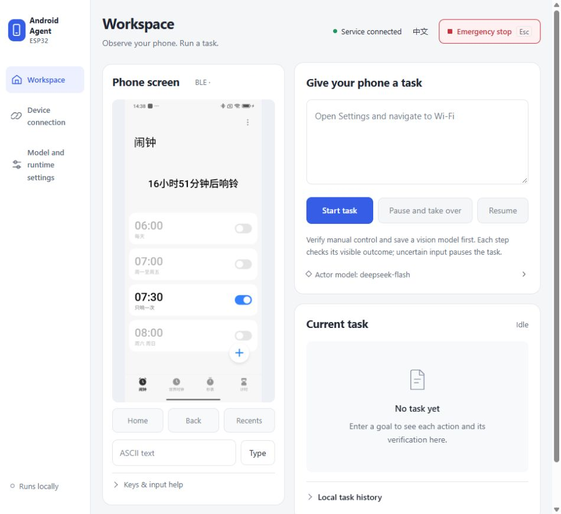
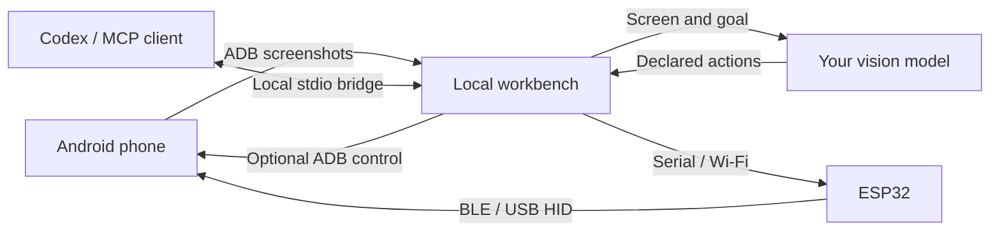

# ESP32 Android Agent

**Let a vision AI operate your real Android phone from your own computer.**

[](https://github.com/shenlan-ai/esp32-android-agent/actions/workflows/ci.yml)

[简体中文](README.zh-CN.md) · [Quick start](#quick-start) · [MCP](#mcp-for-external-agents) · [Real phone examples](#real-phone-examples) · [Compatibility](docs/COMPATIBILITY.md) · [Contributing](CONTRIBUTING.md)

An ESP32 sends keyboard and mouse input, ADB provides screenshots, and a vision model plans and verifies actions. Use the web console for manual control and built-in tasks, or expose the same device to Codex and other agents through **MCP**. The service runs locally with Python, FastAPI and static web assets. No Android companion app or root is required. **ADB control mode** lets you try it before buying a board.



*Current frontend, captured from the running local console with the phone on its Clock alarm list. The saved 07:30 one-time alarm is enabled. The device identifier is redacted; this is a frontend screenshot with a live phone preview. [Image provenance](docs/images/README.md).*

## Why this design

- **Try it first.** ADB control needs no board. Manual control needs no model account, so you can check the screen and input before starting an automatic task.
- **Use a focused console.** Keep the phone and task side by side on desktop; narrow screens put task entry first. Switch between workspace, devices and model settings without losing unsaved inputs. The console supports English/Chinese, keyboard navigation and reduced motion.
- **Connect your own agent.** Optional local stdio MCP shares the selected device and control mode with Codex or another MCP client; the external agent supplies its own vision/reasoning, so no workbench model configuration is needed.
- **Use common hardware.** Classic ESP32 boards act as BLE keyboards/mice without occupying the phone's USB port. S3 profiles offer native USB HID; the installation wizard checks chip and flash compatibility.
- **One less phone-side installation.** Standard ADB screenshots avoid a companion app's installation, capture permissions and background lifecycle. You still need to enable and authorize Android debugging.
- **Inspect the reasoning and result.** The workbench shows plans, actions, screen evidence and usage. Each action is verified; a model's completion claim receives an independent full-goal check.
- **Pause and take over.** Stop releases input. Lost screens or connections pause execution. Uncertain input is observed before recovery, and HID failure never silently switches to ADB input.
- **Maintain firmware in the browser.** Identify → back up and download the full flash → explicitly confirm overwrite → write and read back. Normal pairing/provisioning does not require editing source code.
- **Keep local records and choose your model.** Use an OpenAI-compatible vision endpoint, including a compatible local service. Screenshot saving is off by default; task records can be exported. Automatic tasks send screenshots to the model endpoint you configure.

| Route | Phone setup | Starting point |
|---|---|---|
| ADB screenshots + ADB control | Authorized USB or wireless debugging | Try without hardware and check basic input |
| ADB screenshots + classic ESP32 BLE HID | Debugging authorization + Bluetooth HID pairing | Common ESP32 hardware; phone USB remains available for the computer |
| Wireless ADB screenshots + S3 USB HID | Wireless debugging + OTG / native USB | S3 hardware route; phone-side acceptance is still pending |

## How it works



**Eyes:** authorized ADB screenshots. **Hands:** ESP32 BLE, S3 USB HID or explicit ADB control. **Brain:** plan → observe → validate one action → serialize input → verify the screen, with action, time and token budgets.

## Quick start

Install **Python 3.10+** and Google's [Android Platform Tools](https://developer.android.com/tools/releases/platform-tools). Normal use does not require Node, Arduino IDE or development dependencies.

Windows / PowerShell:

```powershell
git clone https://github.com/shenlan-ai/esp32-android-agent.git
cd esp32-android-agent
python -m venv .venv
.venv\Scripts\python -m pip install -e "./server"
.venv\Scripts\python -m android_agent --open-browser
```

macOS / Linux:

```bash
git clone https://github.com/shenlan-ai/esp32-android-agent.git
cd esp32-android-agent
python3 -m venv .venv
.venv/bin/python -m pip install -e ./server
.venv/bin/python -m android_agent --open-browser
```

1. Enable Developer options and USB debugging, connect a data cable, unlock the phone and authorize your computer.
2. Open `http://127.0.0.1:8890`, go to **Device connection**, refresh devices and connect your phone. Check the screen and a harmless manual tap in **ADB control** mode, then return to **Workspace**.
3. For automatic tasks, save your vision model's API base URL, model name and optional key under **Model & run settings**, then test it. The connection test uses a synthetic image; real tasks send phone screenshots.
4. Prepare a clear starting screen and use a short goal, such as “Open Settings and report whether Wi-Fi is enabled; do not change anything.” Watch execution, pause to take over, or press Esc to stop.

Pass `--adb <absolute-path>` if ADB is not on PATH. `--diagnose` checks the environment; `--port` changes the workbench port. Wireless pairing and connection use separate ports, with discovery and manual entry in the workbench. See [English usage](docs/USAGE.en.md) and [reproducible goals](docs/EXAMPLES.md).

### Console navigation

| View | What to do |
|---|---|
| Workspace | Observe the phone, enter a task, pause/resume, inspect steps and local task records |
| Device connection | Select a phone, pair wireless ADB, configure BLE/USB HID, calibrate and manage firmware |
| Model & run settings | Save/test vision endpoints, configure the optional planner and set execution budgets |

The red **Emergency stop** and **Esc** stop shared input across views. Switching views keeps form drafts; use **Save settings** to persist configuration. Manual control and external MCP agents do not need a workbench model.

### Add an ESP32

| Firmware profile | Chip / flash | Input route | Current evidence |
|---|---|---|---|
| `esp32dev` | Classic ESP32 / 4MB | Computer serial → BLE HID | ESP32-D0WD-V3 rev 3.1 + Redmi Note14 5G tested |
| `esp32_s3_devkitc` | S3 DevKitC-1 N8 / 8MB | Wi-Fi → native USB HID | Compiled and host protocols simulated; phone acceptance pending |
| `xiao_esp32s3` | XIAO ESP32S3 / 8MB | Wi-Fi → native USB HID | Same software-only evidence |
| `esp32_s3_zero` | S3 Zero / 4MB | Wi-Fi → native USB HID | Same software-only evidence |

Keep a classic ESP32 attached to the computer. Pair **Android Agent BLE** on the phone, confirm the target phone in the workbench, select BLE control and calibrate the pointer. S3 is provisioned through native USB on the computer, then moved to the phone's OTG port; screenshots require wireless ADB. [English hardware setup](docs/USAGE.en.md#esp32-hardware).

Source users need the optional `./server[firmware]` dependency and a built image catalog for the web installation wizard, selected with `--firmware-dir <directory>`. See [development instructions](docs/DEVELOPMENT.md). Chip identification cannot establish the commercial PCB model. A CP2102 / CH340 serial bridge does not prove native USB HID support.

### Windows portable package

The Windows x64 build contains Python, the workbench, four firmware profiles, a separate flashing tool, licenses and corresponding sources. Extract the complete directory and run the executable; install Platform Tools separately from Google. **There is no official binary Release yet.** A local development package passed extracted-executable checks in a path containing Chinese characters and spaces. Contributors can [build it](docs/PORTABLE.md) or manually run the GitHub artifact workflow.

## Real phone examples

### Draw in native Notes through MCP

The video shows the complete recorded sequence at **5× speed**: a blank Xiaomi Notes canvas, four strokes and saving. The new note was reopened and verified through MCP after recording. Input used **ESP32-D0WD-V3 / 4MB / BLE 0.1.4**, calibrated for 1080×2400. ADB supplied screenshots and native screen recording; it sent no phone input. The MP4 is 720×1512, H.264, silent and about 138 KiB.

https://github.com/user-attachments/assets/a9684549-7658-43ef-bc77-612e874a5bbe

[Open or download the smiley demo MP4](docs/videos/mcp-notes-smiley.mp4) · [Recording and verification](docs/acceptance/2026-10-14-mcp-smiley-recording.md)

After connecting and calibrating BLE in the workbench and registering MCP, try this goal in Codex:

```text
Use android_agent MCP to create a new note in Xiaomi Notes and draw a smiley
with a round outline, two eyes and a curved smile. Preserve existing notes.
Read status and use only advertised actions. Take a fresh screenshot before
each input and verify afterward. Save, reopen the new note to check the result,
then call android_stop to release input.
```

Navigation and coordinates depend on your phone and current screen; the agent must observe them. Drawing requires calibrated HID: ADB control does not provide continuous `circle`/`path`. The **19-second video is sped up 5×** from a 95-second recording of drawing and saving; it excludes setup and does not represent total task time. [This recording](docs/acceptance/2026-10-14-mcp-smiley-recording.md) and the [earlier new-session acceptance](docs/acceptance/2026-10-13-codex-mcp-notes-smiley.md) document separate runs; neither is a success-rate benchmark.

### Set a one-time alarm through MCP

This second real-device recording uses Codex and `android_agent` MCP to create **tomorrow at 07:30**, save it as **one-time and enabled**, and verify the alarm list. The existing disabled 06:00, 07:00 and 08:00 alarms remain unchanged. It uses the same Android 15 / ESP32 BLE setup. ADB supplies observations and recording; all phone input goes through MCP and BLE.

https://github.com/user-attachments/assets/d2361069-e9da-40d0-9476-7b103fe9ed76

[Download the alarm demo MP4](docs/videos/mcp-alarm-demo.mp4) · [Acceptance and processing details](docs/acceptance/2026-10-14-mcp-alarm-recording.md)

```text
Use android_agent MCP to create a one-time alarm for tomorrow at 07:30.
Preserve existing alarms. Read status, take a fresh screenshot before each
input, and verify the result afterward. Save the new alarm enabled, reopen
it to confirm its time and repeat setting, then call android_stop.
```

The **48-second demo runs at 5× speed**, derived from two recordings totaling about four minutes: creation up to selecting 07:30, followed by a later reopen/settings/save check. Android's recording limit ended the first clip before the initial save; the second clip ends on the enabled alarm list. The gap between them is not recorded. Playback duration is not real task time. Installation and first-use setup happened beforehand; the user completed Clock's privacy choice. Actual ringing was not tested. Choose your intended time when reproducing the task.

### Earlier built-in agent checks

Tested on 2026-10-13 using Windows, **Redmi Note14 5G / Android 15 / API 35**, ESP32-D0WD-V3 / 4MB, BLE **0.1.4**, and the configured `deepseek-flash` model:

| Example | Observed result | Scope |
|---|---|---|
| Draw a smiley | Model chose 2 circles + 1 path; 114.91 seconds, 3 inputs; independent final check passed | Local whiteboard in phone Edge; angular mouth. Not native drawing-app acceptance or precision-curve evidence |
| Create a native hello note | Model created and typed it. After manual intervention, a separate read-only task verified the newer note was saved: 133.03 seconds, 3 taps | Creation task failed to finish automatically; an old test draft was also mistakenly selected. Stable single-run completion is unproven |

Closed paths, circles and release during motion also have real pointer-event and screenshot evidence. The [physical-device report](docs/acceptance/2026-10-13-redmi-note14-ble.md) retains failures and recovery history. Older phone images remain in the repository as historical evidence; they are not used as the current console screenshot.

## Current limits

Android 15 / 16 / 17 are compatibility targets. **Physical evidence currently covers only the Android 15 device above.** Other brands, Android 16/17, S3 hardware, rotation and cable-loss checks remain pending. Relative HID pointer input depends on acceleration and calibration; full-screen pixel accuracy is not guaranteed. Text is printable ASCII. Users switch their IME to English; automatic IME switching and Unicode input are not implemented.

Screens come from ADB screenshots. scrcpy video ingestion, companion apps and parallel phones are not implemented. Protected/black screens pause execution. Models can misjudge; inspect the real result. [Compatibility and software evidence](docs/COMPATIBILITY.md) · [Acceptance checklist](docs/ACCEPTANCE.md) · [Privacy and security](SECURITY.md).

## MCP for external agents

The optional stdio bridge reuses the **running workbench's selected phone, controller and calibration**. It does not open a second serial connection or require a phone app. Install the extra into the same virtual environment, start/update the workbench, connect a phone and choose the input mode in the console. Calibrate HID before coordinate actions.

Windows / PowerShell, from the repository directory:

```powershell
.venv\Scripts\python -m pip install -e "./server[mcp]"
# Start the workbench if it is not already running:
.venv\Scripts\python -m android_agent --open-browser
```

In another terminal, register the bridge with Codex:

```powershell
$agentPython = (Resolve-Path .venv\Scripts\python.exe).Path
codex mcp add android_agent -- $agentPython -m android_agent.mcp --url http://127.0.0.1:8890
codex mcp get android_agent
```

On macOS / Linux, install `./server[mcp]` with `.venv/bin/python`, start the workbench as above, and register its absolute Python path:

```bash
codex mcp add android_agent -- "$PWD/.venv/bin/python" -m android_agent.mcp --url http://127.0.0.1:8890
codex mcp get android_agent
```

Open a **new Codex session** and ask it to use `android_agent` to inspect device status and take a screenshot. Then give it a specific, authorized task. Existing chats may need a new session to discover newly registered tools. Agents may ask for approval before phone input; keep the client's approval policy in place.

| Tool | Purpose |
|---|---|
| `android_status` | Read actual readiness, control mode, available actions and task state |
| `android_screenshot` | Return a JPEG image plus original dimensions and an `observation_id` |
| `android_action` | Execute one advertised action using that fresh observation |
| `android_stop` | Cancel shared tasks/input, invalidate observations and report input release |

Use **status → screenshot → one action → new screenshot to verify**. Coordinates are strict integers **0..1000 over the full screenshot**, not image pixels. Observations expire after 60 seconds and become invalid after submitted input or relevant device/session changes. Never replay an uncertain action; take a new screenshot first. Pause an internal workbench task and wait for release before MCP takeover.

`android_action` exposes every built-in input: `tap`, `swipe`, `path`, `circle`, `long_press`, `scroll`, `type`, `key`, `home`, `back`, `recents` and `wait`. Status returns **current capabilities, allowed keys, action examples and drawing rules**. Calibrated HID supports continuous `path`/`circle`; ADB supports Android navigation and volume keys. Use the selected controller's advertised subset. Internal `done`/`fail`/`replan` decisions belong to task planning and send no phone input.

**Native Notes drawing:** a new Codex desktop session used source MCP to create a Xiaomi Notes entry, draw a smiley, save it and reopen it on the tested Android 15/BLE device. One expired observation was rejected and one list target was mislocated before recovery; see the [acceptance record](docs/acceptance/2026-10-13-codex-mcp-notes-smiley.md). A later recorded replay provides the 5× demo above without replacing that history.

Phone screenshots enter the external agent's model context. The bridge accepts only loopback HTTP addresses; it provides no remote MCP/OAuth, firmware installation or device-selection tools. Portable users currently need a separate Python MCP bridge. Authentication, other MCP-client configuration, action examples and troubleshooting: [MCP guide (Chinese)](docs/MCP.md).

**Actual Codex acceptance:** Codex CLI 0.154.0 received real images and verified BLE taps, ASCII input, stale-observation rejection and stop on the Redmi Note14 / Android 15 / BLE 0.1.4 setup. The first attempt missed the text field; a second attempt succeeded with center-position guidance and visual focus confirmation. This is evidence for the listed setup, not general autonomous accuracy. See the [full report](docs/acceptance/2026-10-13-codex-mcp.md).

## Development and contribution

**Every change uses OpenSpec**, including code, firmware, documentation and tools. [AGENTS.md](AGENTS.md) is authoritative; [agent.md](agent.md) links to it. Read the [development workflow](docs/DEVELOPMENT.md) and [contribution guide](CONTRIBUTING.md). Offline fixtures use fake phone/model IO and visibly display DEMO.

```text
python -m pip install -e "./server[dev]"
python -m pytest -q server/tests
python -m ruff check --config server/pyproject.toml server scripts tools packaging
node --test server/tests/console.test.mjs server/tests/geometry.test.mjs server/tests/board-status.test.mjs
python -m unittest discover -s scripts/tests
openspec validate --all --strict --no-interactive
openspec validate --archived --no-interactive
python scripts/check_changes.py
```

The console redesign passed 9 frontend tests and three consecutive offline browser interaction runs covering navigation/drafts, persisted and failed saves, task controls, responsive layout and 200% CSS zoom; see [UI validation](openspec/changes/archive/2026-10-13-redesign-local-console/validation.md). The latest MCP action-discovery change passed **369 Python tests on each of Python 3.10 and 3.12**, with one Windows symlink-permission skip and one dependency warning; its MCP subset passed 70 tests. [MCP validation](openspec/changes/archive/2026-10-13-complete-mcp-action-discovery/validation.md) records those software checks separately from real-device acceptance. Documentation and media updates do not imply another full regression run.

CI is configured for Ubuntu/Windows × Python 3.10/3.12, web tests and four firmware builds, without devices or paid model services. [Architecture](docs/ARCHITECTURE.zh-CN.md) · [Publication checklist](docs/RELEASING.md).

## Upstream and licenses

Thanks to [onehumanbeing/esp32-iphone-agent](https://github.com/onehumanbeing/esp32-iphone-agent). This project builds on its vision + ESP32 HID approach and portions of code; upstream attribution is preserved in [NOTICE](NOTICE).

Application code is [MIT](LICENSE). The separate [firmware tool](tools/firmware_worker.py) and esptool are **GPL-2.0-or-later**; other firmware dependencies retain their own licenses. Portable distributions include component notices and corresponding sources; the entire package is not all MIT.
