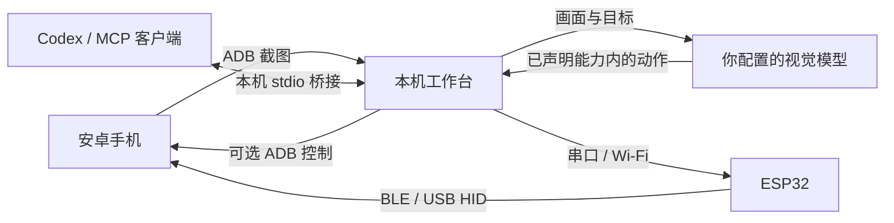

# ESP32 Android Agent

**在自己的电脑上，让视觉 AI 操作真实安卓手机。**

[](https://github.com/shenlan-ai/esp32-android-agent/actions/workflows/ci.yml)

[English](README.md) · [快速开始](#快速开始) · [MCP](#mcp-接入外部-agent) · [实机案例](#真实手机案例) · [兼容性](docs/COMPATIBILITY.md) · [贡献](CONTRIBUTING.md)

ESP32 负责键鼠输入，ADB 提供手机画面，视觉模型负责规划、执行与核验。可以通过网页手动操作和运行内置任务，也可以通过 **MCP** 将同一手机接入 Codex 等外部 Agent。服务在本机运行，使用 Python + FastAPI + 静态网页；手机无需安装伴侣 App，也无需 root。没有开发板时，可以先用 **ADB 控制模式**体验。


*当前前端，来自正在运行的本机控制台，截图时手机停在时钟的闹钟列表，已保存的 07:30 一次性闹钟处于开启状态。设备标识已遮盖；这是包含真实手机预览的前端截图。[图片来源说明](docs/images/README.md)。*

## 为什么这样设计

- **先体验，再接硬件。** ADB 模式无需 ESP32；手动控制无需模型账号，先确认连接、画面和输入，再运行自动任务。
- **工作区更专注。** 桌面手机与任务并排，窄屏先呈现任务入口；切换工作台、设备和模型设置保留未保存输入，支持中英文、键盘导航和减少动态效果。
- **接入自己的 Agent。** 可选本机 stdio MCP 复用当前设备与控制模式；外部 Agent 使用自己的视觉与推理能力，无需配置工作台模型。
- **常见开发板也能用。** 经典 ESP32 通过 BLE 键鼠控制手机，不占手机 USB 口；S3 提供原生 USB HID 路线，板型与 Flash 容量由安装向导核对。
- **少一层手机端安装。** 画面通过标准 ADB 获取，无需额外伴侣 App 的投屏权限、签名或后台保活配置。仍需在手机开启并授权调试。
- **看得到每一步的依据。** 网页显示计划、动作原因、画面证据与用量；动作后核验，模型说“完成”后再独立核验完整目标。
- **能够暂停和接管。** 停止会释放输入；断线或画面丢失暂停自动操作，未知输入结果先观察，HID 失败不会悄悄切换为 ADB 输入。
- **固件维护进入网页。** 识别芯片 → 完整备份并下载 → 明确确认覆盖 → 写入并读取校验，不要求用户修改源码后才能配对或配网。
- **本机记录、可换模型。** 支持 OpenAI 兼容视觉接口与本地兼容服务，截图存盘默认关闭，任务可导出。自动任务的截图会发送到你配置的模型端点。

| 使用路线 | 手机端准备 | 适合的起点 |
|---|---|---|
| ADB 画面 + ADB 控制 | 授权 USB 或无线调试 | 无硬件试用、确认基本操作 |
| ADB 画面 + 经典 ESP32 BLE HID | 调试授权 + 蓝牙键鼠配对 | 常见 ESP32 硬件输入；手机 USB 可继续接电脑 |
| 无线 ADB 画面 + ESP32-S3 USB HID | 无线调试 + OTG / 原生 USB | S3 硬件路线；手机输入实测仍待完成 |

## 如何工作



**Eyes / 画面：** 已授权的 USB 或无线 ADB 截图。**Hands / 输入：** ESP32 BLE、S3 USB HID 或显式 ADB 模式。**Brain / 闭环：** 规划 → 新画面决策 → 严格动作校验 → 串行输入 → 画面核验，配合动作数、时间和 Token 预算。

## 快速开始

需要 **Python 3.10+** 和 Google 官方 [Android Platform Tools](https://developer.android.com/tools/releases/platform-tools)。普通运行无需 Node、Arduino IDE 或开发依赖。

Windows / PowerShell：

```powershell
git clone https://github.com/shenlan-ai/esp32-android-agent.git
cd esp32-android-agent
python -m venv .venv
.venv\Scripts\python -m pip install -e "./server"
.venv\Scripts\python -m android_agent --open-browser
```

macOS / Linux：

```bash
git clone https://github.com/shenlan-ai/esp32-android-agent.git
cd esp32-android-agent
python3 -m venv .venv
.venv/bin/python -m pip install -e ./server
.venv/bin/python -m android_agent --open-browser
```

1. 手机开启“开发者选项 → USB 调试”，用数据线连接电脑，解锁并允许调试授权。
2. 打开 `http://127.0.0.1:8890`，进入“设备连接”，刷新设备、选择手机并连接；先在 **ADB 控制模式**查看画面、测试无副作用的手动点击，再返回“工作台”。
3. 自动任务需要视觉模型：在“模型与运行设置”保存 API 基础地址、模型名和可选密钥，点击“测试模型”。测试只使用合成图；真实任务才发送手机截图。
4. 准备明确的起始画面，输入一个短目标，例如“打开设置，查看 Wi-Fi 是否开启，不修改设置”。观察执行，必要时暂停接管或按 Esc 停止。

ADB 不在 PATH 时传入 `--adb <绝对路径>`；`--diagnose` 检查环境，`--port` 更换端口。无线配对和连接使用不同端口，网页提供发现与手动连接入口。详见[自动任务与人工接管](docs/AGENT-USAGE.md)、[可复现示例](docs/EXAMPLES.md)。

### 控制台导航

| 视图 | 用途 |
|---|---|
| 工作台 | 观察手机、输入任务、暂停/恢复、查看步骤和本机记录 |
| 设备连接 | 选择手机、无线 ADB 配对、BLE/USB HID 配置、校准与固件维护 |
| 模型与运行设置 | 保存/测试视觉接口、设置可选规划模型与执行预算 |

红色“紧急停止”和 **Esc** 可跨视图停止共享输入。切换视图保留草稿，配置持久化需点击“保存设置”。手动操作与外部 MCP Agent 无需工作台模型。

### 接入 ESP32

| 固件配置 | 芯片 / Flash | 控制方式 | 当前验证 |
|---|---|---|---|
| `esp32dev` | 经典 ESP32 / 4MB | 电脑串口 → BLE HID | ESP32-D0WD-V3 rev 3.1 + Redmi Note14 5G 实测 |
| `esp32_s3_devkitc` | S3 DevKitC-1 N8 / 8MB | Wi-Fi → 原生 USB HID | 编译、主机协议模拟通过；手机实测待完成 |
| `xiao_esp32s3` | XIAO ESP32S3 / 8MB | Wi-Fi → 原生 USB HID | 同上 |
| `esp32_s3_zero` | S3 Zero / 4MB | Wi-Fi → 原生 USB HID | 同上 |

经典 ESP32 接电脑，在手机蓝牙中配对 **Android Agent BLE**，网页确认手机、切换 BLE 控制并校准指针。S3 先用原生 USB 接电脑配网，再连接手机 OTG；画面须通过无线 ADB 获取。[BLE 上手](docs/BLE-SETUP.md) / [S3 USB 上手](docs/USB-SETUP.md)。

源码运行时，网页固件向导还需要 `./server[firmware]` 和构建后的镜像目录，启动传 `--firmware-dir <目录>`；具体构建和完整备份流程见[开发说明](docs/DEVELOPMENT.md)。芯片识别无法确定商品 PCB 名称；CP2102 / CH340 串口桥也不代表支持 USB HID。

### Windows 便携包

已实现 Windows x64 ZIP 构建：包含 Python、工作台、四板固件、独立刷写工具及许可和对应源码。用户解压完整目录后运行 exe，另外从 Google 安装 Platform Tools。**当前没有正式二进制 Release**，本机开发包已通过中文/空格路径的真实 exe 验收；贡献者可按[便携包说明](docs/PORTABLE.md)构建，或手动运行 GitHub 构建工作流。

## 真实手机案例

### 通过 MCP 在原生笔记画笑脸

视频以 **5 倍速**展示完整录制内容：小米笔记空白画布、四笔绘图及保存。录制结束后通过 MCP 返回列表、重新打开新笔记核验。实际输入使用 **ESP32-D0WD-V3 / 4MB / BLE 0.1.4**，按 1080×2400 画面校准；ADB 仅提供截图及原生录屏，没有发送手机输入。MP4 为 720×1512、H.264、无声，约 138 KiB。

https://github.com/user-attachments/assets/a9684549-7658-43ef-bc77-612e874a5bbe

[打开或下载笑脸演示 MP4](docs/videos/mcp-notes-smiley.mp4) · [录制和核验记录](docs/acceptance/2026-10-14-mcp-smiley-recording.md)

在工作台连接并校准 BLE、注册 MCP 后，可向 Codex 提出：

```text
使用 android_agent MCP 在小米笔记中新建一条笔记，画一个有圆形轮廓、
两只眼睛和弯曲笑嘴的笑脸，保留已有笔记。先读取状态，只用已声明能力。
每次输入前重新截图，输入后核验；保存并重新打开新笔记确认结果，
最后调用 android_stop 释放输入。
```

导航及坐标取决于当前手机和页面，需要 Agent 实际观察。绘图要求已校准 HID；ADB 控制不提供连续 `circle`/`path`。**19 秒视频是 95 秒实录的 5 倍速版本**，仅覆盖绘图和保存，不含连接设置，播放时长不代表实际任务耗时。[本次录制](docs/acceptance/2026-10-14-mcp-smiley-recording.md)和[此前新会话验收](docs/acceptance/2026-10-13-codex-mcp-notes-smiley.md)是两次独立运行，不能据此推断通用成功率。

### 通过 MCP 设置一次性闹钟

第二段实机录像使用 Codex 和 `android_agent` MCP 设置**明天 07:30** 的一次性闹钟，保存为**开启**状态并核验列表。已有的 06:00、07:00、08:00 闹钟保持关闭。采用同一 Android 15 / ESP32 BLE 环境；ADB 提供观察和录屏，全部手机输入经 MCP 和 BLE。

https://github.com/user-attachments/assets/d2361069-e9da-40d0-9476-7b103fe9ed76

[下载闹钟演示 MP4](docs/videos/mcp-alarm-demo.mp4) · [验收及处理说明](docs/acceptance/2026-10-14-mcp-alarm-recording.md)

```text
使用 android_agent MCP 新建明天 07:30 的一次性闹钟，保留已有闹钟。
先读取状态，每次输入前重新截图，输入后核验。保存为开启状态，
重新打开确认时间和重复设置，最后调用 android_stop。
```

**约 48 秒演示为 5 倍速版本**，来自总计约四分钟的两段实录：新建并选择 07:30，以及稍后重新打开、核验设置和保存。Android 录屏上限使第一段在首次保存前结束，第二段以开启的闹钟列表结束；中间间隔未录制。播放时长不代表实际任务耗时。安装和首次设置在此前完成，时钟隐私选择由用户处理。未验证实际响铃；复现时请明确你需要的时间。

### 此前内置 Agent 验收

2026-10-13，Windows 主机、**Redmi Note14 5G / Android 15 / API 35**、经典 ESP32-D0WD-V3 / 4MB、BLE **0.1.4**，使用已配置的 `deepseek-flash`：

| 案例 | 实际结果 | 验收边界 |
|---|---|---|
| 白板画笑脸 | 模型选择 2 个 circle + 1 条 path，114.91 秒、3 次输入；独立最终核验通过 | 手机 Edge 内的本机测试白板，嘴为有棱角的折线；不是原生绘图 App 或精细曲线精度证明 |
| 原生笔记写 hello | 模型新建并输入；人工介入后，单独只读任务核对新笔记已保存，133.03 秒、3 次点击 | 创建任务自动结束失败，也发生过误选旧测试草稿；尚未证明单次全自动稳定完成 |

闭合 path、circle 和运动中停止释放也有真实指针事件与截图证据。失败与恢复记录保留在[完整实机报告](docs/acceptance/2026-10-13-redmi-note14-ble.md)。旧手机图片继续保留在仓库作历史记录，不用作当前控制台截图。

## 当前边界

适配目标为 Android 15 / 16 / 17，**实际手机证据目前只覆盖上述 Android 15 设备**。其他品牌、Android 16/17、S3 实物、旋转与拔线过程仍待验证。HID 相对鼠标受手机加速与校准影响，不保证全屏像素精度；基础输入为可打印 ASCII，输入法由用户切到英文，尚未实现自动输入法切换或 Unicode 输入。

当前闭环以 ADB 截图为画面来源；scrcpy 视频采集、手机伴侣 App、多手机并行尚未实现。保护/黑屏会暂停任务。模型会误判，需检查实际结果。[兼容与软件验证](docs/COMPATIBILITY.md) / [实机验收清单](docs/ACCEPTANCE.md) / [隐私与安全](SECURITY.md)。

## MCP 接入外部 Agent

可选 stdio 桥接复用**已运行工作台选中的手机、控制器与校准**，不重复打开串口，不要求手机 App。在同一虚拟环境安装 extra，启动或更新工作台，在网页连接手机并选择控制模式；HID 坐标操作需先校准。

仓库目录下 Windows / PowerShell：

```powershell
.venv\Scripts\python -m pip install -e "./server[mcp]"
# 工作台尚未运行时启动：
.venv\Scripts\python -m android_agent --open-browser
```

另一个终端注册 Codex 桥接：

```powershell
$agentPython = (Resolve-Path .venv\Scripts\python.exe).Path
codex mcp add android_agent -- $agentPython -m android_agent.mcp --url http://127.0.0.1:8890
codex mcp get android_agent
```

macOS / Linux 用 `.venv/bin/python` 安装 `./server[mcp]`、按上述步骤启动工作台，再注册绝对路径：

```bash
codex mcp add android_agent -- "$PWD/.venv/bin/python" -m android_agent.mcp --url http://127.0.0.1:8890
codex mcp get android_agent
```

打开**新的 Codex 会话**，让它使用 `android_agent` 读取状态和截图，再给出明确授权的任务；已有聊天可能不会自动发现新工具。真实手机输入可能需要客户端审批，保留客户端审批策略。

| 工具 | 用途 |
|---|---|
| `android_status` | 读取真实就绪状态、控制模式、可用动作与任务状态 |
| `android_screenshot` | 返回 JPEG 图片、原始尺寸与 `observation_id` |
| `android_action` | 使用新观察凭据执行一个已声明动作 |
| `android_stop` | 取消共享任务/输入、作废观察并报告释放结果 |

调用顺序为**状态 → 截图 → 一个动作 → 新截图核验**。坐标为完整截图的 **0..1000 严格整数**，不是图片像素；观察最长60秒有效，提交输入或相关设备/会话变化后失效。未知结果不得重放，先重新截图。接管前暂停内部工作台任务并等待释放。

`android_action` 提供全部内置输入：`tap`、`swipe`、`path`、`circle`、`long_press`、`scroll`、`type`、`key`、`home`、`back`、`recents`、`wait`。状态返回**当前能力、可用按键、动作示例和绘图规则**。校准后的 HID 支持连续 `path`/`circle`，ADB 支持安卓导航与音量键；只使用所选控制器声明的子集。内置 `done`/`fail`/`replan` 属于任务编排，不向手机发送输入。

**原生笔记绘图：** 新 Codex 桌面会话通过源码 MCP 在已测试的 Android 15/BLE 手机上新建小米笔记、绘制笑脸、保存并重新打开核验。过程中拒绝了一次过期凭据，列表误定位一次后恢复；见[验收记录](docs/acceptance/2026-10-13-codex-mcp-notes-smiley.md)。后续重演提供上方 5 倍速演示，保留原验收历史。

手机截图会进入外部 Agent 的模型上下文。桥接仅接受本机 loopback HTTP，不提供远程 MCP/OAuth、固件安装或设备选择工具；便携版目前需独立 Python 桥接。鉴权、其他客户端配置、动作示例与排错见 [MCP说明](docs/MCP.md)。

**实际 Codex 验收：** CLI 0.154.0 已接收真实图片，并在 Redmi Note14 / Android 15 / BLE 0.1.4 验证点击、ASCII 输入、旧凭据拒绝与停止。首轮误定位输入框，第二轮在中心位置提示和视觉焦点确认后通过。这只证明所列环境，不代表任意页面自主定位准确；见[完整报告](docs/acceptance/2026-10-13-codex-mcp.md)。

## 开发与贡献

所有更改通过 **OpenSpec** 管理，含代码、固件、文档和工具。主规范是 [AGENTS.md](AGENTS.md)，[agent.md](agent.md) 为同一规范入口。先读[开发流程](docs/DEVELOPMENT.md)和[贡献指南](CONTRIBUTING.md)，无硬件时使用明确标有 DEMO 的假手机/假模型演示。

```text
python -m pip install -e "./server[dev]"
python -m pytest -q server/tests
python -m ruff check --config server/pyproject.toml server scripts tools packaging
node --test server/tests/console.test.mjs server/tests/geometry.test.mjs server/tests/board-status.test.mjs
python -m unittest discover -s scripts/tests
openspec validate --all --strict --no-interactive
openspec validate --archived --no-interactive
python scripts/check_changes.py
```

新版控制台通过9项前端测试和连续三次离线浏览器交互验证，覆盖导航/草稿、保存刷新与失败、任务控制、响应式和200% CSS缩放，见[UI验证记录](openspec/changes/archive/2026-10-13-redesign-local-console/validation.md)。最新 MCP 动作发现变更在 **Python 3.10 与 3.12 各通过369项测试**，各有1项 Windows 符号链接权限跳过、1项依赖警告，MCP 专项70项通过；[MCP验证记录](openspec/changes/archive/2026-10-13-complete-mcp-action-discovery/validation.md)区分这些软件检查与实机证据。文档和媒体更新不代表再次执行完整回归。

CI 配置涵盖 Ubuntu/Windows × Python 3.10/3.12、网页测试与四板编译，不要求手机、开发板或付费模型。架构、发布准备见[架构说明](docs/ARCHITECTURE.zh-CN.md)、[发布指引](docs/RELEASING.md)。

## 上游与许可

感谢 [onehumanbeing/esp32-iphone-agent](https://github.com/onehumanbeing/esp32-iphone-agent) 的开源工作。本项目借鉴其视觉 + ESP32 HID 思路与部分代码，保留上游版权和来源：[NOTICE](NOTICE)。

应用代码使用 [MIT](LICENSE)；独立[固件工具](tools/firmware_worker.py)与 esptool 使用 **GPL-2.0-or-later**，其他固件依赖遵循各自许可。便携分发包含组件声明与对应源码，整个分发包并非全部 MIT。
